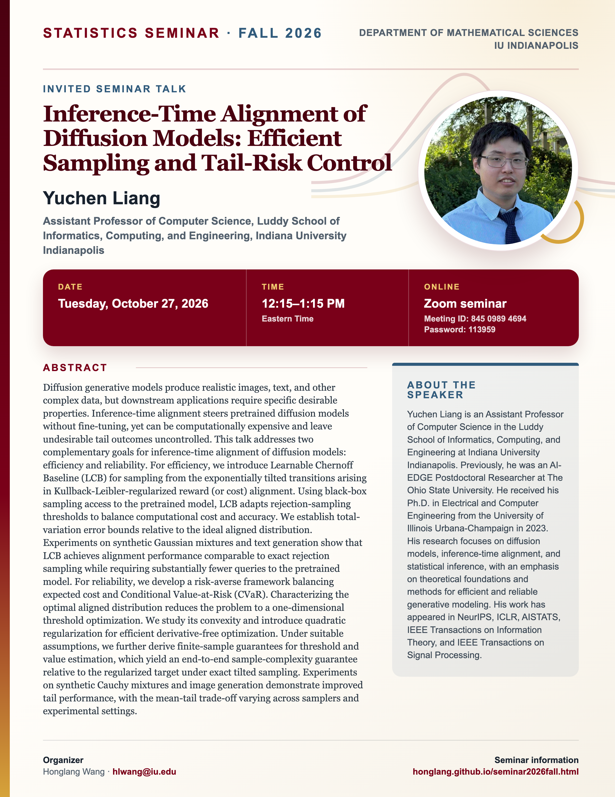

## Statistics Seminar: Fall 2026

**Speaker**: Yuchen Liang, Assistant Professor of Computer Science, Luddy School of Informatics, Computing, and Engineering, Indiana University Indianapolis

**Talk time**: Tuesday, October 27, 2026, 12:15–1:15 PM Eastern Time

**Online via Zoom**: Join from a computer or mobile device using [Zoom](https://iu.zoom.us/j/84509894694?pwd=K1F1c3JickhKREgwd3luellRVVpSUT09), or use Meeting ID **845 0989 4694** with Password **113959**.

## Abstract

Diffusion generative models produce realistic images, text, and other complex data, but downstream applications require specific desirable properties. Inference-time alignment steers pretrained diffusion models without fine-tuning, yet can be computationally expensive and leave undesirable tail outcomes uncontrolled. This talk addresses two complementary goals for inference-time alignment of diffusion models: efficiency and reliability. For efficiency, we introduce Learnable Chernoff Baseline (LCB) for sampling from the exponentially tilted transitions arising in Kullback-Leibler-regularized reward (or cost) alignment. Using black-box sampling access to the pretrained model, LCB adapts rejection-sampling thresholds to balance computational cost and accuracy. We establish total-variation error bounds relative to the ideal aligned distribution. Experiments on synthetic Gaussian mixtures and text generation show that LCB achieves alignment performance comparable to exact rejection sampling while requiring substantially fewer queries to the pretrained model. For reliability, we develop a risk-averse framework balancing expected cost and Conditional Value-at-Risk (CVaR). Characterizing the optimal aligned distribution reduces the problem to a one-dimensional threshold optimization. We study its convexity and introduce quadratic regularization for efficient derivative-free optimization. Under suitable assumptions, we further derive finite-sample guarantees for threshold and value estimation, which yield an end-to-end sample-complexity guarantee relative to the regularized target under exact tilted sampling. Experiments on synthetic Cauchy mixtures and image generation demonstrate improved tail performance, with the mean-tail trade-off varying across samplers and experimental settings.

## About the Speaker

Yuchen Liang is an Assistant Professor of Computer Science in the Luddy School of Informatics, Computing, and Engineering at Indiana University Indianapolis. Previously, he was an AI-EDGE Postdoctoral Researcher at The Ohio State University. He received his Ph.D. in Electrical and Computer Engineering from the University of Illinois Urbana-Champaign in 2023. His research focuses on diffusion models, inference-time alignment, and statistical inference, with an emphasis on theoretical foundations and methods for efficient and reliable generative modeling. His work has appeared in NeurIPS, ICLR, AISTATS, IEEE Transactions on Information Theory, and IEEE Transactions on Signal Processing.

[View the seminar flyer and full event page](/seminars/YuchenLiang/index.qmd).

<!--Include social share buttons-->


