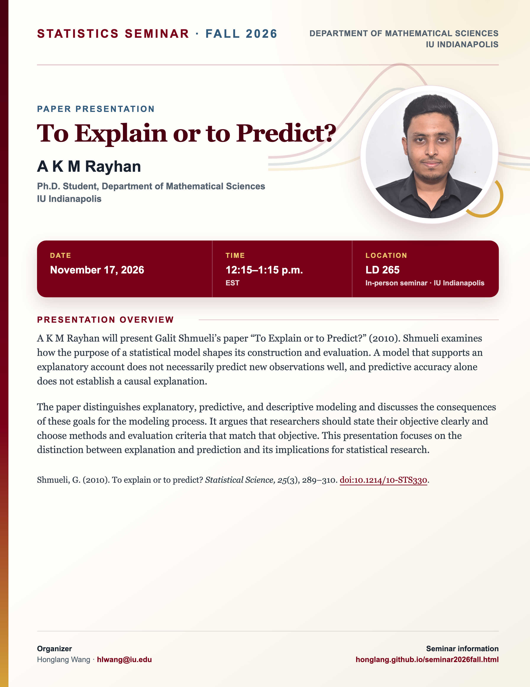

## Statistics Seminar: Fall 2026

**Speaker**: A K M Rayhan, Ph.D. Student, Department of Mathematical Sciences, IU Indianapolis

**Talk time**: November 17, 2026, 12:15–1:15 p.m. EST

**Meeting format**: In person in seminar room **LD 265**, IU Indianapolis.

## Presentation overview

A K M Rayhan will present Galit Shmueli’s paper “To Explain or to Predict?” (2010). Shmueli examines how the purpose of a statistical model shapes its construction and evaluation. A model that supports an explanatory account does not necessarily predict new observations well, and predictive accuracy alone does not establish a causal explanation.

The paper distinguishes explanatory, predictive, and descriptive modeling and discusses the consequences of these goals for the modeling process. It argues that researchers should state their objective clearly and choose methods and evaluation criteria that match that objective. This presentation focuses on the distinction between explanation and prediction and its implications for statistical research.

[View the seminar flyer and full event page](/seminars/AKMRayhan/index.qmd).

<!--Include social share buttons-->



**Paper**: Shmueli, G. (2010). To explain or to predict? *Statistical Science, 25*(3), 289–310. [https://doi.org/10.1214/10-STS330](https://doi.org/10.1214/10-STS330).

[View the Fall 2026 seminar schedule](/seminar2026fall.qmd).
