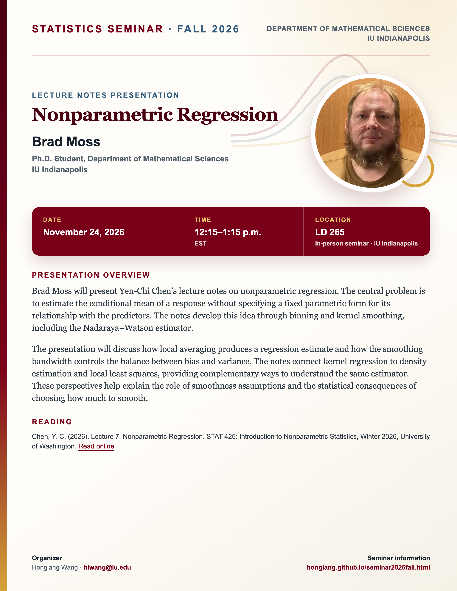

## Statistics Seminar: Fall 2026

**Speaker**: Brad Moss, Ph.D. Student, Department of Mathematical Sciences, IU Indianapolis.

**Talk time**: November 24, 2026, 12:15–1:15 p.m. EST

**Meeting format**: In person in seminar room **LD 265**, IU Indianapolis.

## Presentation overview

Brad Moss will present Yen-Chi Chen’s lecture notes on nonparametric regression. The central problem is to estimate the conditional mean of a response without specifying a fixed parametric form for its relationship with the predictors. The notes develop this idea through binning and kernel smoothing, including the Nadaraya–Watson estimator.

The presentation will discuss how local averaging produces a regression estimate and how the smoothing bandwidth controls the balance between bias and variance. The notes connect kernel regression to density estimation and local least squares, providing complementary ways to understand the same estimator. These perspectives help explain the role of smoothness assumptions and the statistical consequences of choosing how much to smooth.

## Readings

Chen, Y.-C. (2026). Lecture 7: Nonparametric Regression. STAT 425: Introduction to Nonparametric Statistics, Winter 2026, University of Washington. [Read online](https://faculty.washington.edu/yenchic/26W_stat425/Lec7_NPregression.pdf).

[View the Fall 2026 seminar schedule](/seminar2026fall.qmd).


