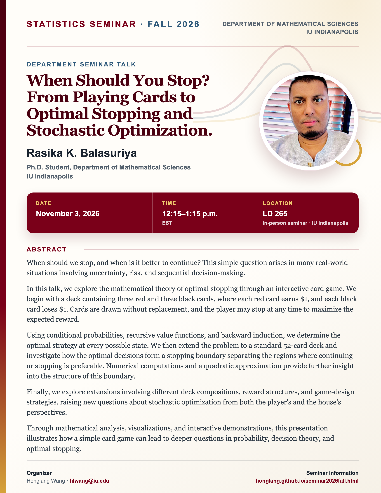

## Statistics Seminar: Fall 2026

**Speaker**: Rasika K. Balasuriya, Ph.D. Student, Department of Mathematical Sciences, IU Indianapolis

**Talk time**: November 3, 2026, 12:15–1:15 p.m. EST

**Location**: Seminar room LD 265, IU Indianapolis (in person).

## Abstract

When should we stop, and when is it better to continue? This simple question arises in many real-world situations involving uncertainty, risk, and sequential decision-making.

In this talk, we explore the mathematical theory of optimal stopping through an interactive card game. We begin with a deck containing three red and three black cards, where each red card earns \$1, and each black card loses \$1. Cards are drawn without replacement, and the player may stop at any time to maximize the expected reward.

Using conditional probabilities, recursive value functions, and backward induction, we determine the optimal strategy at every possible state. We then extend the problem to a standard 52-card deck and investigate how the optimal decisions form a stopping boundary separating the regions where continuing or stopping is preferable. Numerical computations and a quadratic approximation provide further insight into the structure of this boundary.

Finally, we explore extensions involving different deck compositions, reward structures, and game-design strategies, raising new questions about stochastic optimization from both the player's and the house's perspectives.

Through mathematical analysis, visualizations, and interactive demonstrations, this presentation illustrates how a simple card game can lead to deeper questions in probability, decision theory, and optimal stopping.

[View the seminar flyer and full event page](/seminars/RasikaBalasuriya/index.qmd).

<!--Include social share buttons-->


