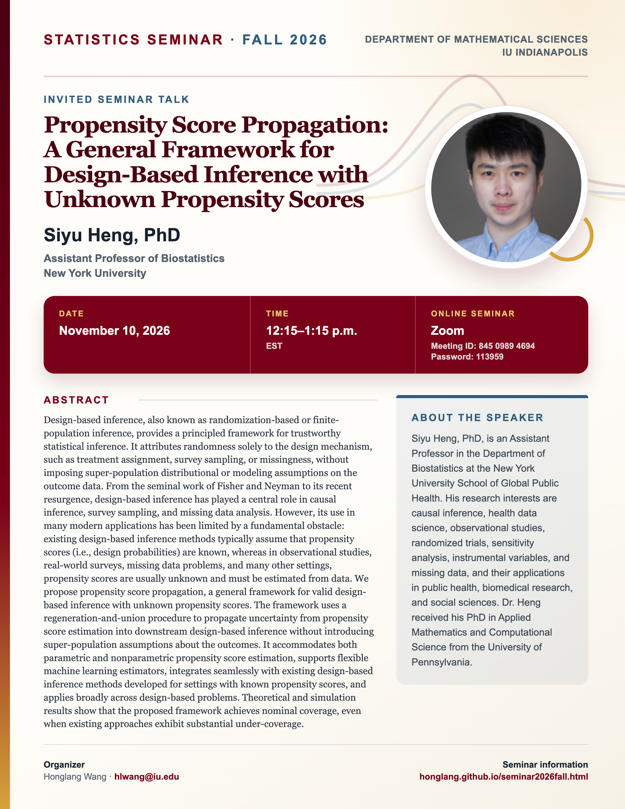

## Statistics Seminar: Fall 2026

**Speaker**: Siyu Heng, [Assistant Professor of Biostatistics, New York University](https://www.hengsiyu.com/)

**Talk time**: November 10, 2026, 12:15–1:15 p.m. EST

**Meeting format**: Online via [Zoom](https://iu.zoom.us/j/84509894694?pwd=K1F1c3JickhKREgwd3luellRVVpSUT09). Meeting ID: **845 0989 4694**. Password: **113959**.

## Abstract

Design-based inference, also known as randomization-based or finite-population inference, provides a principled framework for trustworthy statistical inference. It attributes randomness solely to the design mechanism, such as treatment assignment, survey sampling, or missingness, without imposing super-population distributional or modeling assumptions on the outcome data. From the seminal work of Fisher and Neyman to its recent resurgence, design-based inference has played a central role in causal inference, survey sampling, and missing data analysis. However, its use in many modern applications has been limited by a fundamental obstacle: existing design-based inference methods typically assume that propensity scores (i.e., design probabilities) are known, whereas in observational studies, real-world surveys, missing data problems, and many other settings, propensity scores are usually unknown and must be estimated from data. We propose propensity score propagation, a general framework for valid design-based inference with unknown propensity scores. The framework uses a regeneration-and-union procedure to propagate uncertainty from propensity score estimation into downstream design-based inference without introducing super-population assumptions about the outcomes. It accommodates both parametric and nonparametric propensity score estimation, supports flexible machine learning estimators, integrates seamlessly with existing design-based inference methods developed for settings with known propensity scores, and applies broadly across design-based problems. Theoretical and simulation results show that the proposed framework achieves nominal coverage, even when existing approaches exhibit substantial under-coverage.

## About the Speaker

Siyu Heng, PhD, is an Assistant Professor in the Department of Biostatistics at the New York University School of Global Public Health. His research interests are causal inference, health data science, observational studies, randomized trials, sensitivity analysis, instrumental variables, and missing data, and their applications in public health, biomedical research, and social sciences. Dr. Heng received his PhD in Applied Mathematics and Computational Science from the University of Pennsylvania.

[View the seminar flyer and full event page](/seminars/SiyuHeng/index.qmd).

<!--Include social share buttons-->



[View the Fall 2026 seminar schedule](/seminar2026fall.qmd).
