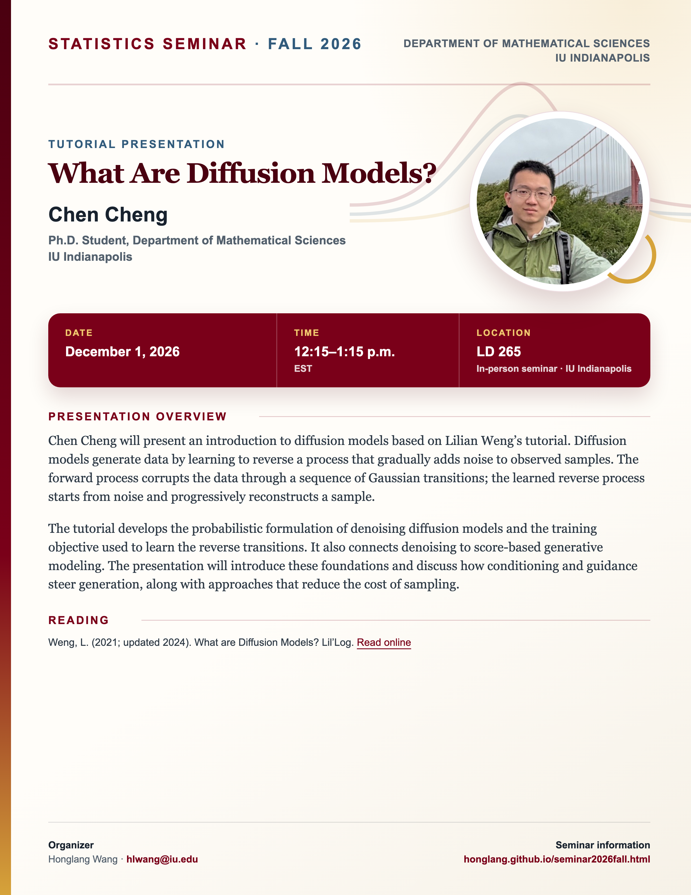

## Statistics Seminar: Fall 2026

**Speaker**: Chen Cheng, Ph.D. Student, Department of Mathematical Sciences, IU Indianapolis.

**Talk time**: December 1, 2026, 12:15–1:15 p.m. EST

**Meeting format**: In person in seminar room **LD 265**, IU Indianapolis.

## Presentation overview

Chen Cheng will present an introduction to diffusion models based on Lilian Weng’s tutorial. Diffusion models generate data by learning to reverse a process that gradually adds noise to observed samples. The forward process corrupts the data through a sequence of Gaussian transitions; the learned reverse process starts from noise and progressively reconstructs a sample.

The tutorial develops the probabilistic formulation of denoising diffusion models and the training objective used to learn the reverse transitions. It also connects denoising to score-based generative modeling. The presentation will introduce these foundations and discuss how conditioning and guidance steer generation, along with approaches that reduce the cost of sampling.

## Readings

Weng, L. (2021; updated 2024). What are Diffusion Models? Lil’Log. [Read online](https://lilianweng.github.io/posts/2021-07-11-diffusion-models/).

[View the Fall 2026 seminar schedule](/seminar2026fall.qmd).


