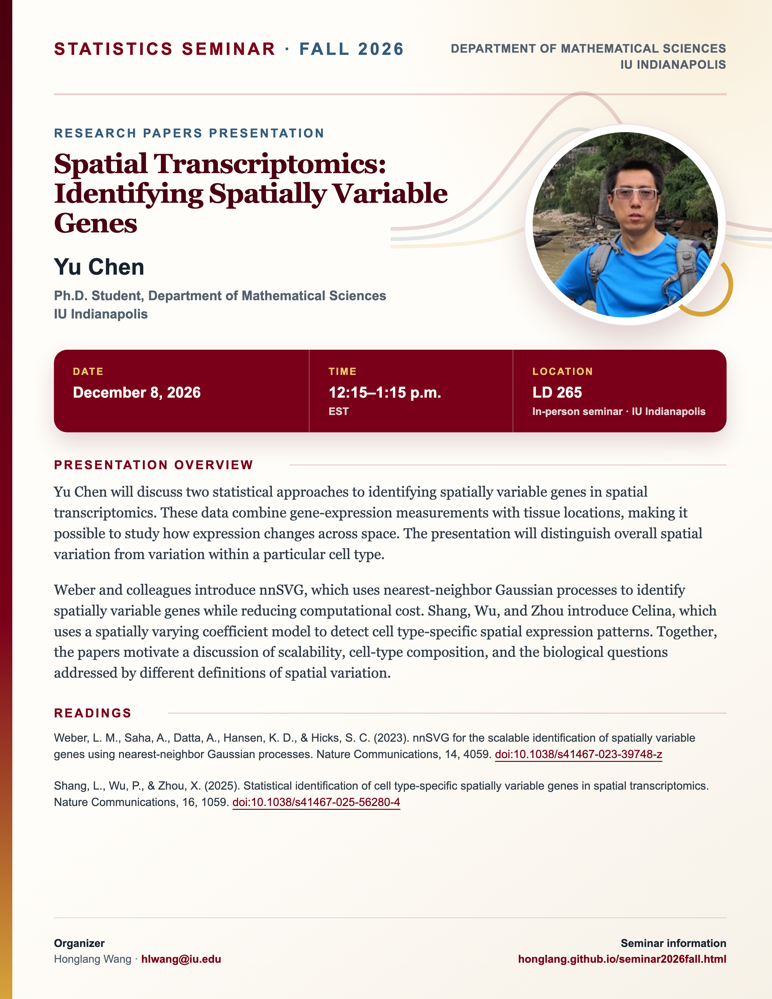

## Statistics Seminar: Fall 2026

**Speaker**: Yu Chen, Ph.D. Student, Department of Mathematical Sciences, IU Indianapolis.

**Talk time**: December 8, 2026, 12:15–1:15 p.m. EST

**Meeting format**: In person in seminar room **LD 265**, IU Indianapolis.

## Presentation overview

Yu Chen will discuss two statistical approaches to identifying spatially variable genes in spatial transcriptomics. These data combine gene-expression measurements with tissue locations, making it possible to study how expression changes across space. The presentation will distinguish overall spatial variation from variation within a particular cell type.

Weber and colleagues introduce nnSVG, which uses nearest-neighbor Gaussian processes to identify spatially variable genes while reducing computational cost. Shang, Wu, and Zhou introduce Celina, which uses a spatially varying coefficient model to detect cell type-specific spatial expression patterns. Together, the papers motivate a discussion of scalability, cell-type composition, and the biological questions addressed by different definitions of spatial variation.

## Readings

Weber, L. M., Saha, A., Datta, A., Hansen, K. D., & Hicks, S. C. (2023). nnSVG for the scalable identification of spatially variable genes using nearest-neighbor Gaussian processes. Nature Communications, 14, 4059. [Read online](https://doi.org/10.1038/s41467-023-39748-z).

Shang, L., Wu, P., & Zhou, X. (2025). Statistical identification of cell type-specific spatially variable genes in spatial transcriptomics. Nature Communications, 16, 1059. [Read online](https://doi.org/10.1038/s41467-025-56280-4).

[View the Fall 2026 seminar schedule](/seminar2026fall.qmd).


